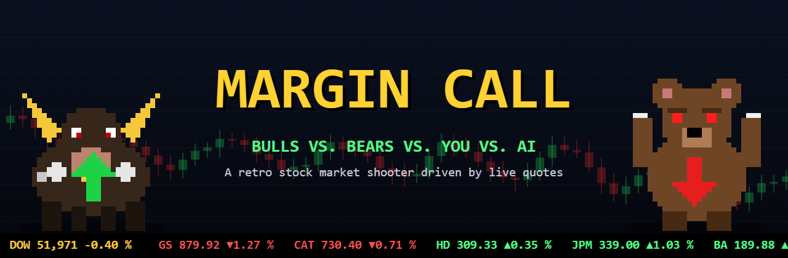
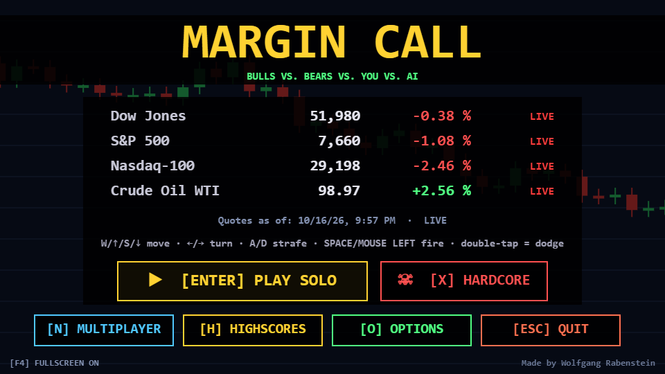
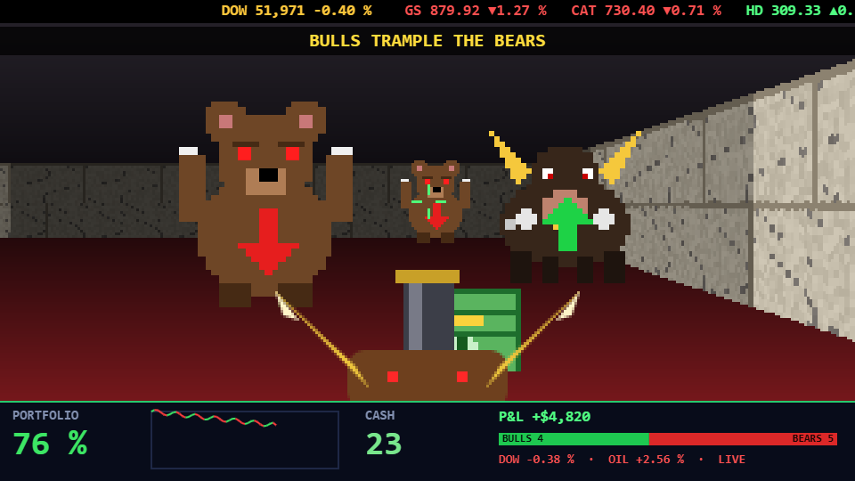

# MARGIN CALL

Ein Börsen-Shooter im Stil von Doom: Bullen und Bären kämpfen gegeneinander und gegen dich, die echten Tageskurse von Dow Jones, S&P 500, Nasdaq-100 und Rohöl bestimmen das Kräfteverhältnis, und die KI ALGO-9000 manipuliert den Markt.

Made by Wolfgang Rabenstein · Open Source unter der [MIT-Lizenz](LICENSE) · [Code signing policy](CODE_SIGNING_POLICY.md)

> **English:** MARGIN CALL is a free, open-source retro first-person shooter set in the stock market. Bulls and bears fight each other and the player; real daily quotes (Dow Jones, S&P 500, Nasdaq-100, crude oil) decide which side is stronger, and the AI "ALGO-9000" manipulates the market. It runs as a small standalone app on Windows, macOS and Linux (Tauri), supports LAN multiplayer for 2–4 players (co-op, team, deathmatch) and also exists as firmware for the M5Stack Cardputer ADV. All binaries are built from this repository by GitHub Actions and published as free downloads on the Releases page.

## Screenshots

| Titelbild mit Live-Kursen | Level 1: Dow Jones |
|---|---|
|  |  |

## Downloads

Aktuelle Version **3.16.0** – Datei anklicken, der Download startet sofort:

| Download | System |
|---|---|
| [**MarginCall-3.16.0-Windows.exe**](https://github.com/wolfgangrabenstein/margincall/releases/download/v3.16.0/MarginCall-3.16.0-Windows.exe) | Windows 10/11 |
| [**MarginCall-3.16.0-macOS.dmg**](https://github.com/wolfgangrabenstein/margincall/releases/download/v3.16.0/MarginCall-3.16.0-macOS.dmg) | macOS 10.15 und neuer (Intel und Apple Silicon) |
| [**MarginCall-3.16.0-Linux.AppImage**](https://github.com/wolfgangrabenstein/margincall/releases/download/v3.16.0/MarginCall-3.16.0-Linux.AppImage) | Linux (x86_64) |
| [**MarginCall-3.16.0-Cardputer.bin**](https://github.com/wolfgangrabenstein/margincall/releases/download/v3.16.0/MarginCall-3.16.0-Cardputer.bin) | M5Stack Cardputer ADV, über den M5Launcher von der SD-Karte |

Neuere Version erschienen? Immer aktuell: [neueste Version](https://github.com/wolfgangrabenstein/margincall/releases/latest) · ältere: [alle Releases](https://github.com/wolfgangrabenstein/margincall/releases) · Änderungen: [CHANGELOG](CHANGELOG.md)

### Erster Start

- **Windows:** SmartScreen meldet eine unbekannte App. Klicke auf „Weitere Informationen“ und dann auf „Trotzdem ausführen“. Fragt die Firewall nach, erlaube den Zugriff im privaten Netzwerk (nötig für den Multiplayer).
- **macOS:** Die App ist nicht von Apple notarisiert.
  1. Öffne die `.dmg`-Datei und ziehe MARGIN CALL in den Ordner „Programme“.
  2. Führe im Terminal einmal `xattr -cr "/Applications/MARGIN CALL.app"` aus.
  3. Starte die App danach normal.
- **Linux:**
  1. Mache die Datei ausführbar: `chmod +x MarginCall-Linux.AppImage`.
  2. Starte sie mit `./MarginCall-Linux.AppImage`.
  3. Bleibt das Fenster leer, fehlt eventuell `libfuse2` (Ubuntu: `sudo apt install libfuse2`).

## Steuerung (PC)

| | Standard |
|---|---|
| Laufen | W / S oder ↑ / ↓ |
| Seitwärts | A / D |
| Drehen | Maus (ins Bild klicken) oder ← / → |
| Feuern | Leertaste oder linke Maustaste |
| Ausweichen | Richtung doppelt antippen |
| Pause | Esc oder P |
| Zurück ins Hauptmenü | Esc im Pausenmenü |
| Beenden | Esc im Hauptmenü |
| Hardcore starten | X im Hauptmenü |
| Sprache (Englisch/Deutsch) | Optionen → Language; Cardputer: L im Titelbild |
| Vollbild | F4 |
| Musik | M |
| Optionen (Tastenbelegung) | O |
| Spielfigur wählen (Multiplayer) | C in der Lobby |
| Highscores | H im Titelbild |
| Chat (Multiplayer) | T |
| Statistik einblenden | Tab (gedrückt halten) |

Alle Tasten lassen sich im Optionsmenü umbelegen. Auf dem Cardputer gilt weiterhin: E/S laufen, A/D drehen, W/R seitwärts.

## Multiplayer (2–4 Spieler im selben Netzwerk)

1. Ein Spieler wählt **[N] Multiplayer → [H] Spiel hosten**. Die Lobby zeigt die Adresse, z. B. `192.168.1.20:8080`.
2. Die anderen wählen **[N] Multiplayer → [J] Spiel beitreten** und klicken das Spiel in der Liste an. Wird es nicht gefunden (manche Router blockieren das), geben sie die Adresse aus der Lobby des Hosts ein oder öffnen sie im Browser.
3. Mitspieler melden sich mit **E** (oder Klick) **bereit**. In der Lobby kann man mit **T** chatten, mit **K** den eigenen Nickname ändern; der Host ändert mit **G** den Spielnamen.
4. Der Host wählt den Modus (Koop, Team Bulle vs. Team Bär oder Deathmatch) und startet, sobald alle bereit sind.

## Projektaufbau

| Ordner | Inhalt |
|---|---|
| `pc/game.html` | Das Spiel (Rendering, Logik, Sounds, Musik, Multiplayer) |
| `pc/server.py` | Entwicklungs-Server (Python), gleiches Verhalten wie der App-Server |
| `desktop/` | Desktop-App (Tauri 2): eingebauter Server in Rust plus Spielfenster |
| `src/`, `platformio.ini` | Cardputer-Firmware (PlatformIO, Arduino) |
| `tools/` | Generatoren für Soundeffekte und das App-Icon |
| `docs/` | Titelbild und Screenshots für die GitHub-Seite |
| `worker/` | Online-Rangliste (Cloudflare Worker + D1), Einrichtung siehe [worker/README.md](worker/README.md) |

### Selbst bauen

- **Desktop:** Benötigt Node 20+, Rust und unter Linux die WebKitGTK-Pakete. Bauen mit `cd desktop && npm install && npx tauri build`.
- **Cardputer:** Bauen mit `pio run`.
- **Alle Plattformen:** Das erledigt automatisch der GitHub-Workflow `.github/workflows/build.yml`.

## Datenschutz

Live-Kurse werden nur geladen, wenn du beim ersten Start zustimmst. Dann fragt das Spiel öffentliche Kursdaten bei Yahoo Finance ab, wobei Yahoo wie bei jedem Webseitenaufruf deine IP-Adresse sieht. Ändern kannst du das jederzeit unter *Optionen → Live-Kurse*. Für die Online-Rangliste gehen Name und Punkte nur an den Ranglisten-Server, wenn du nach einem Lauf „Auch online eintragen“ einschaltest. Sonst überträgt das Spiel nichts; im Multiplayer verbindet es sich nur mit dem Host, dessen Adresse du eingibst. Details: [Code signing policy → Privacy policy](CODE_SIGNING_POLICY.md#privacy-policy--datenschutz).

## Code signing policy

Free code signing provided by [SignPath.io](https://about.signpath.io/), certificate by [SignPath Foundation](https://signpath.org/). Ablauf, Rollen und Datenschutz: [CODE_SIGNING_POLICY.md](CODE_SIGNING_POLICY.md).

## Lizenz & Mitmachen

MARGIN CALL steht unter der [MIT-Lizenz](LICENSE). Beiträge sind willkommen; bitte beachte den [Code of Conduct](CODE_OF_CONDUCT.md).
